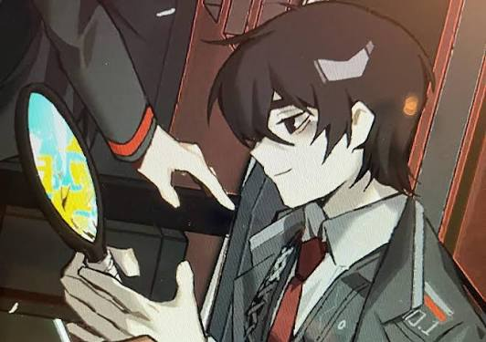
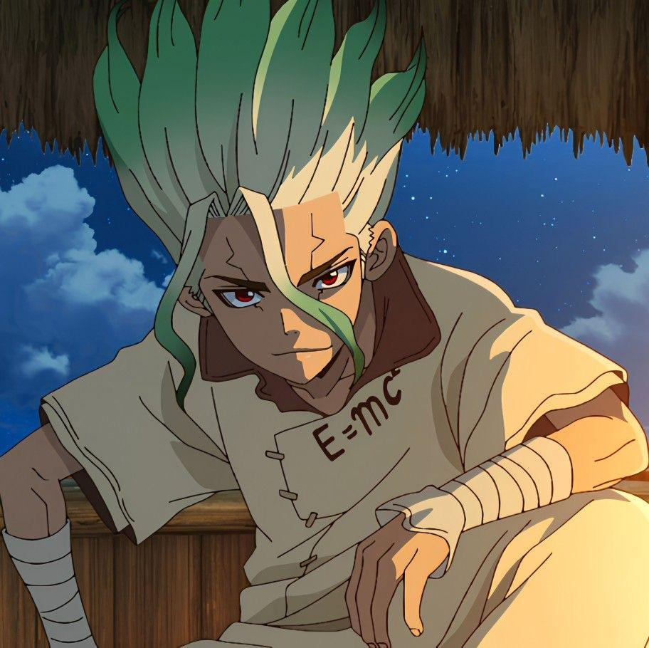

<!-- PALETA NOCHE CÓSMICA Negro espacio #0B0B1A Azul medianoche #1B1F4B Morado nebulosa #8B5CF6 Azul eléctrico #3B82F6 Lavanda estelar #C4B5FD Todo lo que dice TU_... o está entre [corchetes] es para que lo cambies. Carpeta sugerida para tus imágenes: assets/ --> <!-- ✦ BANNER ✦ --> <!-- Edita assets/banner.svg y cambia TU NOMBRE y TU ROL O FRASE CORTA --> 
  
   <!-- ✦ SOBRE MÍ ✦ -->
✦ Sobre mí

Nombre: TU_NOMBRE
Estudio: TU_CARRERA
Enfoque: TU_ENFOQUE (backend, frontend, full stack...)
Ahora mismo: [lo que estás aprendiendo o construyendo]
Contacto: [un solo correo o red, ver sección final]

[Una o dos frases con tu voz: quién eres como dev y qué te mueve.]

 
<!-- ✦ PROYECTO (tarjeta, borde morado) ✦ -->
✦ Proyecto destacado
<table> <tr> <td width="40%" align="center">  </td> <td width="60%"> <h3>🪐 NOMBRE_DEL_PROYECTO</h3> 
[Qué es y para quién, en una frase.]
 
<b>Mi parte:</b> [qué hiciste tú en concreto, con tus palabras]
 
<b>Stack:</b> [tecnologías usadas]
 
<a href="TU_ENLACE_AL_REPO">Ver repositorio →</a>
 </td> </tr> </table>
<!-- ✦ INTERESES (2 tarjetas, borde azul) ✦ -->
☾ Fuera del código
<table> <tr> <td width="50%" align="center">   <b>✦ TÍTULO_DEL_INTERÉS_1</b>  [Dos líneas con tu voz sobre este interés.] </td> <td width="50%" align="center">   <b>☾ TÍTULO_DEL_INTERÉS_2</b>  [Dos líneas con tu voz sobre este interés.] </td> </tr> </table>
<!-- ✦ CONTACTO ✦ -->
✧ Contacto

Correo Show Image

