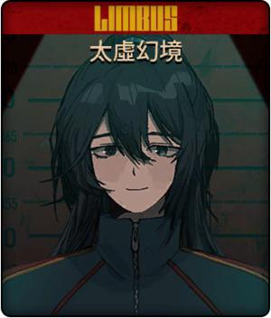

<!-- PALETA NOCHE CÓSMICA Negro espacio #0B0B1A Azul medianoche #1B1F4B Morado nebulosa #8B5CF6 Azul eléctrico #3B82F6 Lavanda estelar #C4B5FD Lo que está entre [corchetes] o dice TU_... es para que lo cambies. Carpeta de imágenes: assets/ --> <!-- ✦ BANNER ✦ --> <!-- Para editar el texto del banner, abre assets/banner.svg --> 
  
   <!-- ✦ SOBRE MÍ ✦ -->
✦ Sobre mí

Nombre: Gabriel Palomino Pinzón

Estudio: Ingeniería de sistemas

Enfoque: Full stack

contacto: gapalominop@cuc.edu.co

correo personal: gspp0525@gmail.com

"Cree que puedes y ya estarás a medio camino."

 
<!-- ✦ PROYECTO (tarjeta) ✦ -->
✦ Proyecto destacado
<table> <tr> <td> <h3>🪐 EcoRoute Logistics</h3> 
SaaS para optimizar las rutas de entrega de flotas pequeñas (menos de 15 vehículos). Incluye panel del administrador, portal del conductor y cálculo de CO₂ ahorrado. React, Node.js/Express y PostgreSQL con PostGIS, desplegado en AWS.
 
<a href="[EcoRoute](https://github.com/EcoRoute-Logistics/EcoRoute-Logistics)">Ver repositorio →</a>
 </td> </tr> </table>
<!-- ✦ INTERESES (2 tarjetas) ✦ -->
☾ Fuera del código
<table> <tr> <td width="50%" align="center">   <b>✦ Escritura</b>  Me gusta escribir. [Es una forma en la que puedo expresar lo que realmente pienso y siento del mundo, dejandolo inmortalizado en un papel.] </td> <td width="50%" align="center">   <b>☾ Matemáticas</b>  Me fascinan las matemáticas. [Simplemente es divertido] </td> </tr> </table>
<!-- ✦ LENGUAJES ✦ -->
✧ Lenguajes

  

